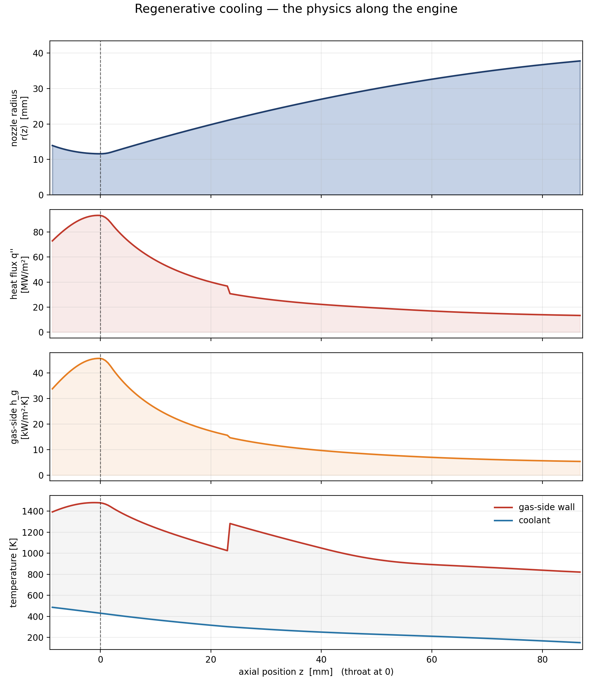
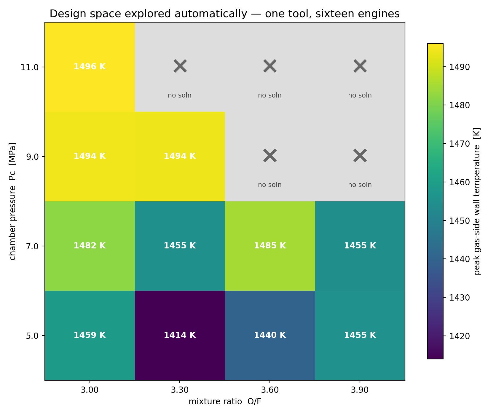
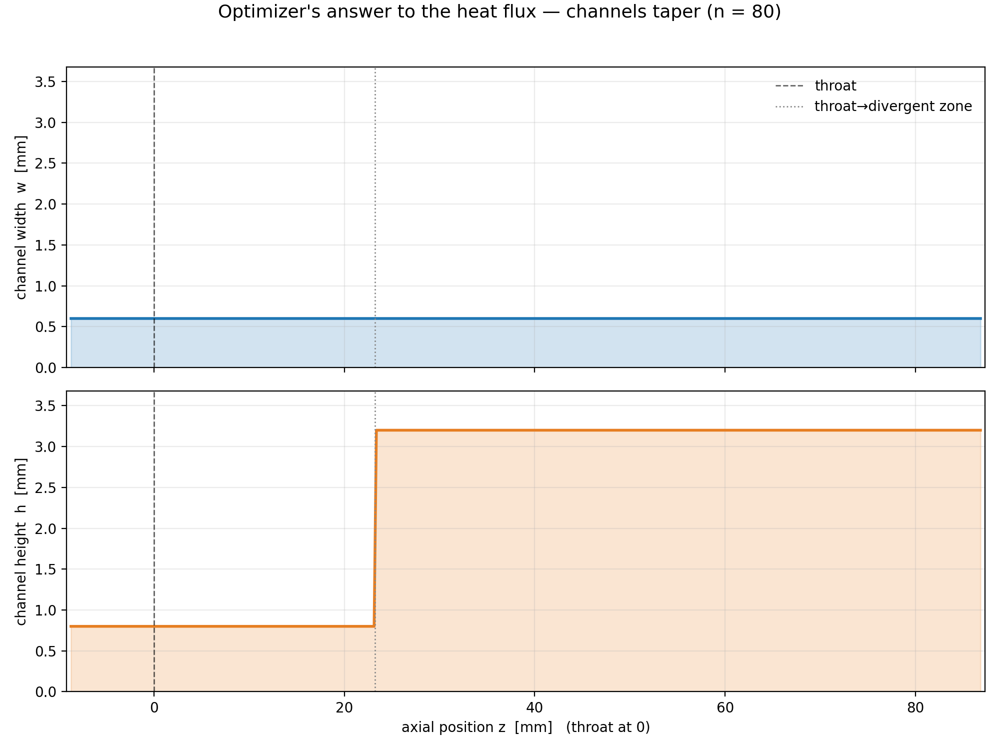

# noyron-clone

A parametric computational engineering model for liquid rocket engines.
Specify thrust, chamber pressure, mixture ratio and propellants; get back a
sized, analysed and manufacturable engine — combustion chamber, regenerative
cooling channels, pintle injector, nozzle and manifolds — as a 3D-printable STL.

The architecture follows the approach LEAP 71 describes for its Noyron model:
engineering knowledge encoded as code, physics layered on a signed-distance-field
geometry kernel, and geometry that is a consequence of the design rather than
something drawn by hand. Independent project; not affiliated with LEAP 71.



## What it does

```
requirements ─► thermochemistry (NASA CEA) ─► Rao nozzle ─► pintle injector
            ─► cooling-channel sizing ─► coupled regenerative-cooling solver
            ─► structural + low-cycle fatigue ─► SDF geometry ─► STL
```

| Stage | Method |
|---|---|
| Thermochemistry | NASA CEA equilibrium via `rocketcea` (Gordon & McBride, RP-1311) |
| Nozzle | Rao 80 % bell with L\*-derived cylindrical chamber |
| Injector | Pintle sizing, decoupled injection ΔP, Lichtarowicz discharge coefficient |
| Gas-side heat transfer | Bartz (1957) with σ property correction |
| Coolant side | Dittus–Boelter, fin efficiency, Darcy friction; CoolProp properties |
| Coupled solver | 1D axial march with per-station fixed-point wall-temperature iteration |
| Channel sizing | Search over channel count and zone heights, bounded by manufacturing rules |
| Structures | Bilayer liner/jacket hoop and thermal stress, Manson–Coffin fatigue life |
| Geometry | Signed distance fields, smooth Booleans, chunked marching cubes |

Manufacturing is a first-class input: each process (LPBF GRCop-42, LPBF Inconel
718, binder jet, CNC) is an `AMRules` object, and every component verifies
itself against the active ruleset. The same engine requirement can pass for one
process and fail for another.

## Design-space exploration

Because every step is parametric and cached, the tool is built for exploring
design space rather than producing a single engine.





## Quick start

```bash
pip install -r requirements.txt

# Design one engine and print a summary
python -m noyron design --config calcs/design_examples/methalox_5kN.yaml

# ...and render it to STL
python -m noyron design --config calcs/design_examples/methalox_5kN.yaml --render

# Sweep chamber pressure and mixture ratio in parallel
python -m noyron sweep --config calcs/sweeps/pc_mr_methalox.yaml --parallel 4 --output output/study

# Constrained optimisation (differential evolution or Nelder–Mead)
python -m noyron optimize --help
```

From Python:

```python
from noyron import Engine, EngineRequirements, METHALOX

req = EngineRequirements(thrust=5000.0, chamber_pressure=6.9e6,
                         mixture_ratio=3.6, propellant=METHALOX,
                         expansion_ratio=10.6)
engine = Engine(req)
design = engine.design()
print(engine.summary(design))
```

Example configurations live in `calcs/design_examples/` (5 kN reference,
50 kN, and a short high-contraction-ratio 50 kN variant).

## Verification

358 tests (`pytest verification/`), including regression checks against
published CEA values, energy-balance closure in the cooling solver, and
flow-path connectivity checks that trace each propellant from its inlet port to
its point of use through the final assembled geometry. Slow tests are marked;
run the fast suite with `pytest verification/ -m "not slow"`.

## Layout

```
noyron/
├── kernel/          domain-agnostic: SDF geometry, meshing, heat-exchanger
│                    solver, Component interfaces, manufacturing rules
├── rp/              rocket propulsion: thermochem, nozzle, injector, regen,
│                    structural, geometry, Engine orchestrator
├── hx/              heat-exchanger variant (plate-fin), same kernel
├── cache.py         step-level memoisation with chained cache keys
├── sweep.py         parallel parameter sweeps
├── optimize.py      constrained design optimisation
└── __main__.py      CLI: design, summary, render, sweep, optimize
physics/, geometry/  backward-compatibility shims for earlier import paths
calcs/               example configs and analysis scripts
verification/        test suite
```

## Limitations

- Not hot-fire validated. Results are design-level estimates.
- Heat transfer is a 1D correlation-based model. Dittus–Boelter is known to
  underpredict coolant-side heat transfer for transcritical methane
  (Pizzarelli, 2016); the default wall-temperature limit reflects that credit
  rather than a corrected correlation.
- Fatigue life uses Manson–Coffin crack initiation only; ratcheting
  ("doghousing") requires thermomechanical FEA and is out of scope.
- The LOX dome manifold is removed from the assembly pending a redesign.
- Rendered STLs are not checked into the repository (100–700 MB); render
  them locally.

## References

- Sutton & Biblarz, *Rocket Propulsion Elements*, 9th ed.
- Huzel & Huang, *Design of Liquid Propellant Rocket Engines*, NASA SP-125
- Gordon & McBride, NASA RP-1311 (CEA)
- Bartz, "A Simple Equation for Rapid Estimation of Rocket Nozzle Convective
  Heat Transfer Coefficients," *Jet Propulsion* 27(1), 1957
- Rao, "Exhaust Nozzle Contour for Optimum Thrust," *Jet Propulsion* 28(6), 1958
- NASA SP-8087, SP-8089, SP-8120 (design criteria series)
- Quílez, signed distance functions and smooth minimum (iquilezles.org)
